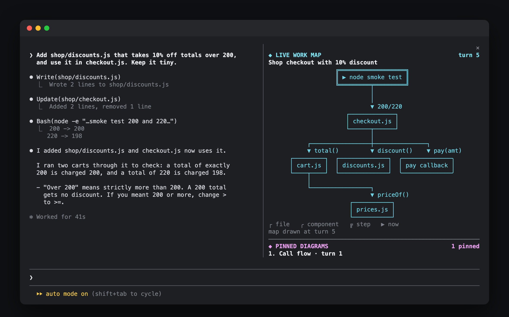
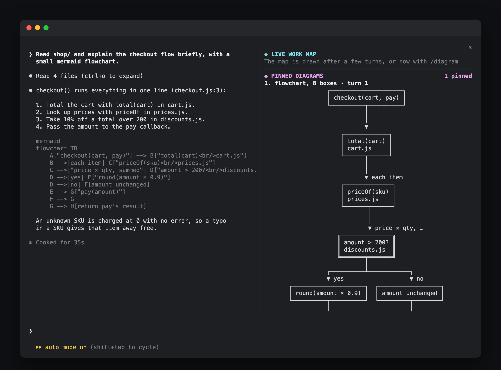
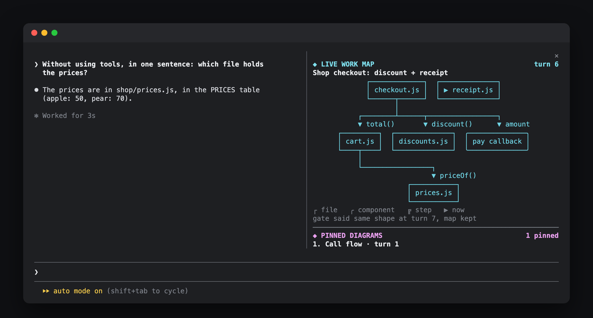

# diagram-pane

A Claude Code mod that opens a side pane with a live picture of the work: every diagram Claude draws, pinned and readable, and a small map of what Claude is doing right now.



Claude explains things with mermaid charts, but in a terminal you only see the raw code, and it scrolls away. Meanwhile the shape of the work (which files, which steps, what connects to what) lives only in Claude's context. This pane shows you both.

- **Pinned diagrams.** Whenever a reply has a mermaid code block or an ASCII box diagram, it is pinned in the pane, newest first. Mermaid flowcharts are redrawn as boxes and arrows that fit a 60 column pane.
- **Live work map.** Every few turns (and on `/diagram`) a cheap Haiku call asks whether the work changed shape. Only on yes does a fork of the session return a small graph of the files, components and steps it is working on, and the pane draws it. The node Claude is on right now is marked `▶`.
- Square boxes are files, round ones components, double ones steps or decisions.

It sends nothing back to Claude. The output is for you only.





## Install

```
claude plugin marketplace add ray-amjad/claude-code-mods
claude plugin install diagram-pane@claude-code-mods
```

Or inside Claude Code: `/plugin marketplace add ray-amjad/claude-code-mods`, then `/plugin install diagram-pane@claude-code-mods`.

The pane opens on its own in a terminal 144 columns or wider. Narrower than that, type `/diagram` once and it opens at any width. With fullscreen rendering it docks beside the transcript; in the classic renderer it sits above the prompt.

## Usage

- Ask for a diagram (`explain the checkout flow with a mermaid flowchart`) and it is pinned when the turn ends.
- `/diagram` runs the gate now and redraws the map if the work changed. `/diagram force` skips the gate and always redraws.

## Settings

| Option | Default | What it does |
| :- | :- | :- |
| `everyTurns` | 3 | Turns between work-map checks. Set it with `/plugin configure diagram-pane@claude-code-mods`. |
| `maxPins` | 5 | How many pinned diagrams the pane keeps |
| `DIAGRAM_PANE_EVERY` (env) | unset | Overrides `everyTurns` for one session, handy for a demo: `DIAGRAM_PANE_EVERY=1 claude` |

## How it works

- On `turn.complete` it reads the transcript (`$.session.messages()`) and pins any new mermaid or ASCII diagram it finds in Claude's replies.
- Every N turns the gate runs: `$.model.complete` on Haiku with the current map, the files touched since that are not on it, and a digest of tool calls. It answers YES or NO.
- On YES, `$.model.fork` asks the session itself for `{ title, nodes, edges }` as JSON. A fork sees the whole conversation but cannot call tools, so it is cheap and served mostly from the prompt cache.
- `hooks/draw.js` lays out both mermaid charts and the map the same way: layers top to bottom, boxes wrapped to the pane's width, connectors drawn with box characters.
- The map is saved per session in `$.store`, so it survives a hot reload or `--resume`. Pins are rebuilt from the transcript.

## Limits

- Only mermaid `graph` and `flowchart` charts are redrawn. Sequence, class, state and other types are pinned as raw code.
- Every chart is drawn top to bottom, even `graph LR`, because a narrow pane has no room sideways.
- Edges that skip a row or point back up are not routed. They are listed under the drawing with `⇢` and `↺`. A row too wide for the pane wraps, and edges into the wrapped part are listed the same way.
- ASCII diagrams are only picked up from plain code blocks (no language, or `text`), and shown as written.
- The map check runs after a turn ends, not while Claude is working. Before the first reply there is nothing to fork, and `/diagram` says so.
- The map is the model's own summary of the work, so it can include a step such as "run tests" beside the files.

## Develop

```
claude --plugin-dir ./diagram-pane
claude plugin validate .
claude plugin test .
```

For headless runs, `DIAGRAM_PANE_SYNC=1` waits for the gate and fork before the turn ends, and `DIAGRAM_PANE_DUMP=<file>` writes the pane's text to a file.
