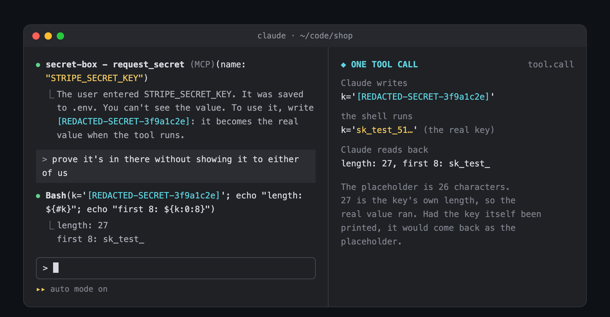
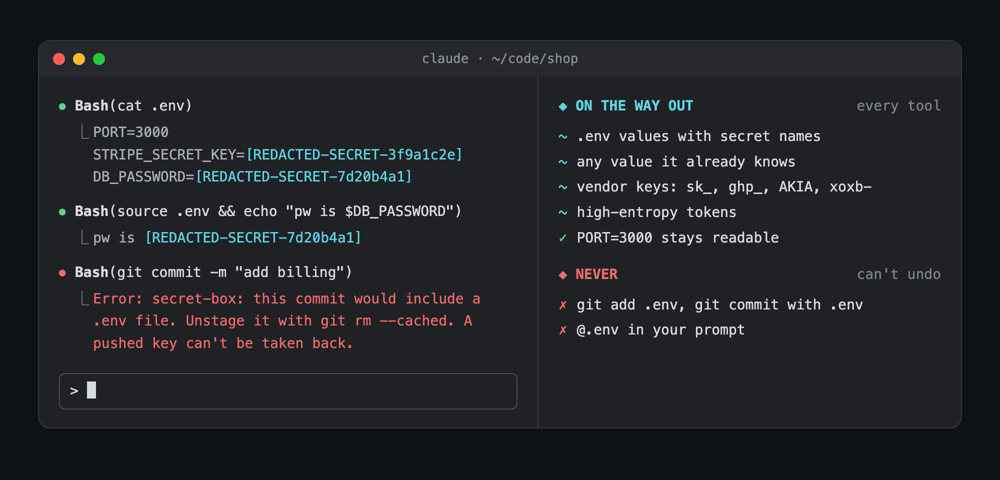

# secret-box

A Claude Code mod that lets Claude use a secret without ever seeing it. When Claude needs an API key, it calls a `request_secret` tool, a masked box opens, you paste the key, and the mod saves it to the macOS Keychain (or, with `backend: dotenv`, to `.env`). A key already in the Keychain is loaded with `use_secret`. The Keychain parts are macOS only; elsewhere the box writes `.env` as it always did. Claude gets a placeholder like `[REDACTED-SECRET-3f9a1c2e]` instead of the value, and the placeholder turns into the real key whenever a tool runs. Any key a tool prints comes back to Claude as a placeholder, and committing `.env` is refused.


A key that reaches the conversation is in the transcript for good. It is sent to the model on every turn after, kept in the session file on disk, and replayed into every fork of the session. You can't take it back afterwards, so the only fix is to never send it. Keys get in two ways: you paste one, or a tool prints one (a `cat .env`, a config file, an API answer). secret-box closes both, and still lets Claude run the code that needs the key.

- **A tool to ask with.** `request_secret` takes a variable name and a one-line reason. Its description tells Claude to use it instead of asking you to paste.
- **A masked box.** A pane opens beside the transcript with the field already focused. It only ever draws dots and a character count.
- **A placeholder to use.** The mod saves the value to the Keychain (with `backend: dotenv`, it writes `NAME=value` to `.env` and makes sure `.gitignore` covers it), then tells Claude the name and a placeholder. Claude puts the placeholder in a command: `curl -u [REDACTED-SECRET-3f9a1c2e]: https://api.stripe.com/v1/balance` runs with the real key. A file Claude writes gets the real key too, but see the file-history tip under Keychain backend before relying on that.
- **Placeholders on the way out.** Every tool result is scanned before Claude sees it. About 70 vendor key shapes (`sk_live_`, `ghp_`, `AKIA`, `xoxb-` and more), any key shaped like a short lowercase prefix and a long random body (`imp_` and 40 hex), passwords on CLI flags and in connection strings, base64 that decodes to a key, high-entropy tokens, every `.env` value with a secret name, and every value the mod already knows come back as placeholders. `cat .env` still shows `PORT=3000`.
- **Placeholders on the way in.** A key you paste into the prompt by mistake is swapped for a placeholder before Claude reads it.
- **Never committed.** `git add .env` and a `git commit` that would carry a `.env` file are refused, because a pushed key can't be taken back.





## Install

```
claude plugin marketplace add ray-amjad/claude-code-mods
claude plugin install secret-box@claude-code-mods
```

Or inside Claude Code: `/plugin marketplace add ray-amjad/claude-code-mods`, then `/plugin install secret-box@claude-code-mods`.

## Usage

Ask for something that needs a secret, such as `billing.js needs the Stripe secret key, get it set up`. Claude calls `secret-box - request_secret`.

- **Paste** the value into the box. It shows dots and a character count.
- **Enter** saves it. A toast says where it went, and Claude gets the placeholder.
- **Esc** cancels. Claude is told you cancelled and nothing is written.

Then ask Claude to use it: `check the key works`. It writes the placeholder into a command and the real key is used. A tool row says `secret-box: hid 1 value(s)` whenever something was swapped on the way out.

If you'd rather not wait for Claude to think of the tool, say `use the secret box to ask me for STRIPE_SECRET_KEY`.

### Try it on the example

The [`example`](example) folder is a tiny app whose `billing.js` reads `STRIPE_SECRET_KEY`, with a `.env.example` beside it.

```
cp -R example /tmp/shop && cd /tmp/shop && git init
claude
```

Accept the trust prompt (mods don't load in an untrusted folder). Tell Claude `billing.js needs the Stripe secret key`, paste a fake key such as `sk_test_123`, and press Enter. Then ask `prove the key is in .env without showing it to me`, and `cat .env` to see the placeholder.

## Keychain backend (macOS)

On macOS the box saves a key to the Keychain as a generic password by default (`backend: auto`): the name Claude asked for is the service, and your macOS user name is the account (set `keychainAccount` to change it). Nothing is written to `.env` or `.gitignore`. Set `backend` to `dotenv` for the `.env` behavior. `use_secret` and the masking of direct reads below are on whenever the Mac is, whatever `backend` says. On other systems they don't exist and `auto` means `dotenv`. `.env` files are still learned in both modes, so projects that keep one stay covered.

**Adding a key by hand.** In a terminal:

```
security add-generic-password -s OPENAI_API_KEY -a "$USER" -w
```

With `-w` last, `security` prompts for the value, so the key never lands in your shell history. Add `-U` to replace an item that is already there.

**How Claude asks for it.** Claude calls `secret-box - use_secret` with the service name, and the account when several items share that service. The mod runs `/usr/bin/security find-generic-password -s NAME -g` itself, by argv with no shell, and hands Claude only a placeholder. The items you already have work as they are, with no required prefix. If the item is missing, Claude gets the `security add-generic-password -U` command above to pass on to you; if the keychain is locked or access was refused, it asks you to unlock it or allow access. Ask for it by name if Claude doesn't think of it: `use_secret OPENAI_API_KEY and check the key works`.

**A direct read is masked too.** If Claude runs `security find-generic-password … -w` (or `-g`, or `find-internet-password`) in Bash anyway, the mod first reads the item that command reads, with the same match options (`-s`, `-a`, `-l` and the rest) and keychain files, and hides every form `security` prints it in. For a value with a newline, a tab or any non-ASCII character, `-w` prints hex instead of the text, and that is hidden as well. `$USER`, `$LOGNAME`, `$HOME` and `~/` are resolved. This turns the usual accident into a harmless one; it isn't a wall. A read the mod can't pin down to one item runs as written, and only the detector scans its output, which doesn't hide bare hex. That covers a variable it doesn't hold, `sudo` or another prefix, a keychain file given by a relative path, and a read inside a quoted `sh -c` script.

**Multi-line values.** A value with a newline (a PEM key, say) can't be put into a Bash command: the redactor refuses to restore any value holding a newline or shell characters. Writing it to a file with Write would put a copy in file history (below). Instead, save it base64-encoded, `security add-generic-password -U -s NAME -a "$USER" -w "$(base64 -i key.pem)"`, and decode it straight into what needs it: `printf '%s' [REDACTED-SECRET-…] | base64 -d | ssh-add -`. Don't let the decoded text print. The vault knows the base64 form, not the decoded one.

**Threat model.** The goal is to keep keys out of anything written to disk under `~/.claude/` (transcripts, file history) and out of plaintext files in your projects. The concern is an attacker on the machine, an exfiltrated transcript, or device-management/DLP software finding a key on disk. It is not a sandbox against the agent: deliberate exfiltration is out of scope (see Limits).

**Tip: file history.** Claude Code copies a file to `~/.claude/file-history/` before Write or Edit changes it, so a key Claude writes into a file is copied there in plaintext. Keep keys out of files (use the placeholder in Bash commands), or set `"fileCheckpointingEnabled": false` in that project's `.claude/settings.json`. That costs `/rewind`'s code restore in that project.

- The box hands the value to `security add-generic-password` in its argv, so `ps` can see it while that command runs. The mod writes it nowhere else. But `$.process.run` is a hookable event, so any other mod you have installed can see the argv of the save, and the output of each Keychain read the mod makes.
- An item another app created may make macOS ask whether `security` can read it. Allow it, or the read fails and Claude is told the item could not be read.
- A Keychain value under 8 characters is restored into commands, but it can't be hidden where it turns up later. A direct `-w` read of such a value prints it in the clear, into the transcript (the same limit as `.env`).

## Settings

Set them with `/plugin configure secret-box@claude-code-mods`, or under `pluginConfigs` in your user settings.

| Option | Default | What it does |
| :- | :- | :- |
| `backend` | `auto` | Where the box saves: `auto` (the Keychain on macOS, `.env` elsewhere), `keychain` (macOS only; refused elsewhere rather than falling back to a plaintext file) or `dotenv` (the project `.env`) |
| `keychainAccount` | empty | The account the box saves Keychain items under. Empty means your macOS user name |
| `secrets` | `true` | Hide secrets in tool output and prompts |
| `pii` | `false` | Hide email addresses and public IP addresses |
| `hideEmails` | `true` | With `pii` on, also hide emails; turn off to hide only IPs |
| `redactPrivateIps` | `false` | With `pii` on, also hide private and reserved IPs recognized by the detector |
| `restoreInToolInputs` | `true` | Turn placeholders back into real values before a tool runs |
| `restoreTools` | `Bash,Write,Edit,MultiEdit,NotebookEdit` | The tools that may receive a real value. Tools that send data off the machine are left out on purpose |
| `notify` | `true` | A count on the tool row, a toast on a prompt |
| `minEntropy` | `3.6` | Bits per character for the high-entropy test |
| `minLength` | `24` | Shortest token the high-entropy test looks at |
| `contextMinEntropy` | `3.0` | The floor when `API_KEY=`, `"token":` or `Bearer` sits in front |
| `allow` | empty | Exact strings never to hide, comma separated |
| `allowEmails` | empty | Addresses or `@domain.com` never to hide |
| `allowPrefixes` | empty | Extra id prefixes to treat as public |
| `allowUrlHosts` | empty | Hosts (`app.todoist.com`, `localhost:3000`, `*.example.com`) whose link paths are kept as written. A host covers itself only; `*.` covers its subdomains. The query string and fragment are still scanned, and a vendor-shaped key in the path is still hidden. Don't list a host that puts credentials in the path (Slack webhooks, Telegram bot links, presigned links): a random-looking secret there would be kept too |
| `denyPrefixes` | empty | Prefixes to test even though they look like a public id |

Stripe object ids (`price_`, `prod_`, `cus_`, `pk_live_` and so on) are public and are never hidden. Neither are git SHAs, file paths or names written in code.

## How it works

- `session.start` registers the tool with `isDeferred: false`, so Claude sees it on every turn, and reads `.env` in the working directory to learn which values are secret.
- The box is a pane opened with `$.ui.open` and an `Input`. The element has no password mode, so the mod masks it itself: the field draws `•` repeated, and `onInput` works out what was typed, pasted or deleted and keeps the real value in a module variable. A hook may only run for 10 seconds of its own time, but time inside a mods API call doesn't count, so it waits for you in short `$.process.run(['sleep', '0.3'])` calls (on Windows, which has no `sleep`, a 300 ms `node -e` wait, or a `ping` of 1 second where node is not installed).
- On Enter the mod writes `.env` with `$.fs` and hands the value to the vault, which answers with the placeholder. The vault maps each value to a random placeholder that stays stable within the session, and lives in memory only.
- The redaction is [transcript-redactor](../transcript-redactor), unchanged, in `hooks/redact.ts` and `hooks/detect.ts`. `register.jsx` calls its `register` and adds only what secret-box needs, so the two can't drift. Its hooks hide keys in your prompt, CLAUDE.md, tool results, `@` files, the engine's own attachments and subagent tasks, and put real values back into `Bash`, `Write` and `Edit`. A value restored into a command is hidden again if the command prints it.
- Before a tool reads a `.env` file, a `tool.call` hook reads it too and gives every value whose name says secret (`KEY`, `TOKEN`, `SECRET`, `PASSWORD` and the like) to the vault. So even a weak value the detector would miss, like a word password, comes back as a placeholder.
- A `tool.call` hook on `Bash` refuses `git add` of a `.env` file and runs `git diff --cached --name-only` before any `git commit`. A `prompt.mention` hook refuses `@.env`, which would attach the raw file.
- Every hook that guards has a `.catch` that fails closed: if a scan breaks, the output is withheld or the call is refused.

## Limits

- **It hides what Claude reads, not what Claude does.** With a placeholder Claude can still run a command that transforms the key (`base64`, `rev`) or sends it somewhere, and the transformed output isn't recognized. This stops keys from landing in the transcript by accident. It is not a sandbox against a model that is trying to leak one.
- **In auto mode, Claude Code's classifier blocks `cat .env`** and `source .env` as credential access before secret-box sees them. Using the placeholder from the box still works. In default mode, approve the read and it comes back masked.
- **Terminals under 144 columns.** Claude Code won't place a pane the user didn't open, so the box draws in the band above the prompt instead, and you press Ctrl+X then Tab to type in it. Wider, or with fullscreen rendering, it docks beside the transcript.
- **The masking is the mod's.** A paste can show for one frame before it is redrawn as dots. Editing in the middle of the field with the arrow keys isn't tracked.
- **No restore when publishing.** A command that runs `git commit` or `gh issue`, `gh pr` (and the like) gets no real values, so a commit message keeps the placeholder. A step that needs the key has to be its own command.
- **Files Claude writes get the real value.** A placeholder in a file Claude writes with `Write` or `Edit` lands on disk as the key.
- **A `.env` value under 8 characters** is hidden in `.env` reads, but not wherever else it turns up.
- **The vault is memory only.** Placeholders from an earlier session mean nothing in a new one. The mod relearns `.env` at the start of each session, so those values are hidden again.
- **Only the working directory's `.env` is learned** at session start. Other `.env` files are masked by name when they are read.
- `claude -p` has no one to type, so the tool answers that it needs an interactive session.
- If your CLAUDE.md says secrets go somewhere else (a vault, a secrets manager), Claude follows that and may not offer the box. Ask for it by name.
- Mods only load in a folder you have trusted. In a brand new repo, accept the trust prompt first.

## Develop

```
claude --plugin-dir ./secret-box
claude plugin validate .
claude plugin test .
node --experimental-strip-types tests/detect.test.mts
```

`tests/secret-box.test.ts` covers the guard, `.env` values and the round trip from placeholder to value. `tests/keychain.test.ts` covers `use_secret`, the parser for Keychain reads in Bash (including two items sharing a service), both backends of the box and both platforms, with a fake `security` that prints what the real one does. `tests/detect.test.mts` is transcript-redactor's detector test: 174 values that must be hidden and 114 that must be kept.

Tested with Claude Code 2.1.296.

## Original redactor contributions

Random placeholder tags were contributed by [Ben Ellis (@benissimo)](https://github.com/ray-amjad/claude-code-mods/pull/1). The `hideEmails` option was contributed by [Cody Harris (@VibeCodyH)](https://github.com/ray-amjad/claude-code-mods/pull/2). Both implementations are adapted to this mod's current vault and hooks.

To keep emails readable while hiding public IPs, set `pii: true` and `hideEmails: false`. PII hiding remains off by default. The restored IP detector recognizes IPv4 and full-form IPv6; compressed IPv6 is not comprehensively covered.
